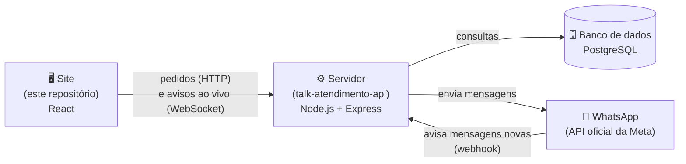
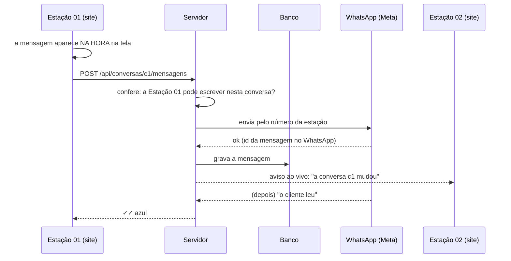

# Talk Atendimento

**Uma central de atendimento pelo WhatsApp para equipes que trabalham em estações e turnos.**

Várias pessoas atendendo os clientes ao mesmo tempo, cada estação com o seu número de WhatsApp, supervisão acompanhando tudo, e cada mensagem registrada com a estação que enviou e em qual turno.

🔗 **Ver funcionando:** https://thepaulojorge.github.io/talk-atendimento/
(clique em **"Entrar na demonstração"**: as conversas são fictícias)

> ⏳ O servidor está num plano gratuito, que "dorme" depois de 15 minutos parado. O primeiro acesso pode levar até 1 minuto. A tela avisa enquanto isso acontece.

Este repositório é o **site** (a parte que a equipe usa). O **servidor** (API, banco de dados e WhatsApp) está em [talk-atendimento-api](https://github.com/thepaulojorge/talk-atendimento-api).

---

## Sumário

1. [O problema que ele resolve](#1-o-problema-que-ele-resolve)
2. [Um tour pelo sistema](#2-um-tour-pelo-sistema)
3. [Quem faz o quê (papéis)](#3-quem-faz-o-quê-papéis)
4. [Como funciona por dentro](#4-como-funciona-por-dentro)
5. [Segurança](#5-segurança)
6. [Tecnologias](#6-tecnologias)
7. [Rodar no seu computador](#7-rodar-no-seu-computador)
8. [Organização das pastas](#8-organização-das-pastas)
9. [Limitações conhecidas e próximos passos](#9-limitações-conhecidas-e-próximos-passos)
10. [Como o projeto foi construído](#10-como-o-projeto-foi-construído)

---

## 1. O problema que ele resolve

Numa central de atendimento por WhatsApp, o dia a dia costuma ser assim:

| Situação | Sem o sistema | Com o Talk Atendimento |
|---|---|---|
| Cada estação tem um número de WhatsApp | Um celular (ou um WhatsApp Web) por estação | Todos os números numa tela só |
| Colega sai para o intervalo ("rendição") | Logar no WhatsApp do outro, ou abrir mais uma janela | **Puxar a estação** do colega: as conversas dela entram na sua lista, com um selo (E02) |
| Fim de semana: uma pessoa cobre 3 ou 4 estações | Várias janelas lado a lado | Puxa as 4 estações e atende tudo na mesma lista |
| "Quem respondeu isso para o cliente?" | Ninguém sabe ao certo | Cada mensagem tem a estação que enviou, e a auditoria mostra o turno |
| Alguém apagou ou editou uma mensagem | O conteúdo se perde | A supervisão vê o original, na auditoria |
| Combinar algo com a equipe sobre um cliente | Grupo paralelo, papel, memória | **Nota interna** amarela, dentro da própria conversa (o cliente não vê) |
| Saber de quem é cada conversa | Confusão | Fila (ninguém atendendo), "Assumir", "Transferir", "Resolvida" |

---

## 2. Um tour pelo sistema

### Login por estação

Cada estação tem o **seu e-mail de login** (criado pela empresa, ex.: `estacao01@suaempresa.com.br`) e o **seu número de WhatsApp**. Entrou com o e-mail, já está na estação, com o número dela: não importa quem está sentado ali.

O horário do login fica registrado como o **turno** da estação, nos horários da empresa:

| Turno | Horário |
|---|---|
| Manhã | 7h às 15h |
| Tarde | 15h às 23h |
| Noite | 23h às 7h |

Atrasos não atrapalham: quem entra às 7h10 ou às 15h17 cai direto no turno certo, sem nenhuma pergunta. Na supervisão, cada registro mostra a estação **e o turno** (ex.: "Estação 01 · Tarde").

O sistema foi pensado para **dezenas de estações** (testado com 70), com busca em todas as listas. A demonstração tem 10; o README da API explica como gerar 70.

### A lista de conversas

- **Filtros:** Todas, Novas (na fila), Não lidas e, no "Mais ▾": Minhas, Resolvidas, Grupos, por etiqueta e por estação
- **Busca** por nome, número (em qualquer formato) ou trecho de mensagem
- **Fixar** (até 3), **arquivar**, **marcar como não lida**
- **Prévia** ao passar o mouse; **menu** no botão direito (ou segurando o dedo, no celular)

### A conversa

- Texto, **áudio gravado** na hora, **fotos**, **documentos** (PDF, Word, Excel…) e **áudios** do computador, pelo botão **+**
- **Responder** citando uma mensagem, **encaminhar**, **editar** e **apagar** (as suas)
- **Respostas rápidas:** digite `/` e escolha (`/saudacao`, `/placa`, `/boleto`…)
- **Nota interna:** só a equipe vê
- **Assumir**, **transferir** para um colega (ou devolver para a fila), **marcar como resolvida**
- **Etiquetas** coloridas (algumas com nome personalizável)
- ✓✓ ficam azuis quando o cliente lê

### Estações (a "rendição")

O ícone **Estações** mostra todas as estações (com busca), as que estão com você primeiro, e quem já puxou qual. Marcou a caixinha, as conversas daquela estação entram na sua lista. Sem cronômetro: fica com você até desmarcar ou sair do sistema.

### Supervisão

O painel de **Supervisão** mostra:
- mensagens **editadas** (com o antes e o depois)
- mensagens **apagadas** (com o conteúdo original)
- conversas **excluídas** (com uma cópia de todas as mensagens)

Cada registro diz quem fez (a estação), em qual turno e quando. Dá para filtrar (por estação, turno, ação e período) e **exportar em CSV** (abre no Excel).

### Configurações (supervisão e diretoria)

- **Estações:** criar e editar cada uma (nome, sigla, e-mail e senha do login, número de WhatsApp e a ligação com a **Meta**, o WhatsApp oficial), bloquear o login sem apagar o histórico, com busca por nome, e-mail ou número
- **Números exclusivos** da supervisão e da diretoria
- **Nome da empresa** que aparece no sistema (*white-label*: o mesmo sistema serve para qualquer empresa). Só a diretoria muda

### Tudo ao vivo

O que uma pessoa faz aparece **na hora** na tela das outras: mensagem nova, conversa assumida, etiqueta, transferência. Mensagem de cliente chegando mostra um aviso ("Nova mensagem de Mariana").

### No celular

A mesma tela se adapta: a barra de ícones vai para o rodapé, os menus sobem do pé da tela e a conversa ocupa a tela inteira. Tem tema **claro** e **escuro**.

---

## 3. Quem faz o quê (papéis)

| | Atendente (estação) | Supervisão | Diretoria |
|---|:---:|:---:|:---:|
| Atender as conversas da sua estação | ✅ | — | — |
| Puxar outras estações | ✅ | — | — |
| Número de WhatsApp exclusivo | — | ✅ | ✅ |
| Ver o painel de Supervisão (auditoria) | — | ✅ | ✅ |
| Ver o conteúdo de mensagens apagadas e editadas | — | ✅ | ✅ |
| Cadastrar estações e números | — | ✅ | ✅ |
| Mudar o nome da empresa | — | — | ✅ |

### Contas da demonstração

Todas com a senha `demo123`:

| E-mail | Quem entra |
|---|---|
| `estacao01@talk.com` até `estacao10@talk.com` | A estação (as 3 primeiras têm conversas de exemplo) |
| `supervisao@talk.com` | Beatriz (Supervisão) |
| `diretoria@talk.com` | Helena (Diretoria) |

> 💡 Para ver o tempo real funcionando: abra uma janela normal com `estacao01@talk.com` e uma **janela anônima** com `supervisao@talk.com`, lado a lado. Edite uma mensagem na primeira e veja o registro aparecer na segunda.

---

## 4. Como funciona por dentro

O sistema tem três partes:



| Parte | O que faz | Onde está publicada |
|---|---|---|
| **Site** | As telas. Não guarda nada importante: só mostra e pede | GitHub Pages |
| **Servidor** | As regras: quem pode ver o quê, o que fica registrado, a conversa com o WhatsApp | Render |
| **Banco** | Onde tudo fica guardado (conversas, mensagens, auditoria…) | Neon |

### O caminho de uma mensagem enviada



Dois detalhes que deixam a tela rápida:

- **Atualização otimista:** a tela mostra a mudança **antes** de o servidor confirmar. Se o servidor recusar (ex.: passou das 24 horas do WhatsApp), aparece um aviso e a tela volta a ficar igual ao banco.
- **Fila de pedidos:** os pedidos saem um de cada vez, na ordem. Assim um "editar" nunca chega antes do "enviar".

### O estado do site (para quem programa)

O site usa **useReducer + Context** do React. Toda mudança é uma **ação** descrita num objeto (`{ tipo: "assumirConversa", id: "c3" }`):

1. o **reducer** (`src/estado/reducer.js`) calcula a tela nova: uma função **pura**, sem efeitos colaterais
2. o **sincronizar** (`src/estado/sincronizar.js`) traduz a mesma ação num pedido para o servidor
3. o **tempo real** (Socket.io) traz as mudanças dos outros como novas ações

Os componentes não sabem que existe um servidor: só despacham ações.

---

## 5. Segurança

A regra de ouro: **o site não decide nada**. Esconder um botão na tela não é segurança (qualquer um abre o F12). Quem decide é o servidor, a cada pedido.

| Proteção | Como |
|---|---|
| Senhas | Nunca guardadas: só o *hash* (bcrypt) |
| Login | Token JWT assinado, válido por 12 horas. O papel da pessoa é conferido no banco a cada pedido |
| Força bruta | Limite de 10 tentativas de login erradas a cada 15 minutos |
| Mensagem de erro do login | Sempre a mesma ("E-mail ou senha incorretos"), para não revelar quais e-mails existem |
| Quem vê o quê | Cada pessoa só recebe as conversas das linhas que atende. Texto apagado só vai para a supervisão |
| Arquivos | Só abrem com login, e só para quem vê a conversa. Tipos permitidos numa lista fechada (HTML e SVG recusados), até 10 MB |
| WhatsApp | Cada aviso da Meta tem a assinatura conferida (HMAC SHA-256). Avisos falsos são recusados |
| Demonstração | Quem entra pelo botão da demonstração nunca enxerga linhas ligadas ao WhatsApp de verdade |
| Segredos | Senhas e chaves ficam em variáveis de ambiente, fora do código e do GitHub |

---

## 6. Tecnologias

| Parte | Tecnologia | Para quê |
|---|---|---|
| Site | **React 19** + **Vite** | Telas e componentes |
| Site | CSS puro (com variáveis) | Visual, tema claro/escuro, celular |
| Site | **Socket.io (cliente)** | Atualizações ao vivo |
| Servidor | **Node.js 22** + **Express 5** | A API |
| Servidor | **Prisma 7** + **PostgreSQL** | Banco de dados |
| Servidor | **Socket.io** | Tempo real |
| Servidor | **JWT** + **bcrypt** | Login |
| Servidor | **ffmpeg** | Converter o áudio gravado no navegador para o formato do WhatsApp |
| Integração | **WhatsApp Cloud API** (Meta) | Enviar e receber mensagens de verdade |
| Publicação | GitHub Pages, Render, Neon | Site, servidor e banco na nuvem (planos gratuitos) |

---

## 7. Rodar no seu computador

Você vai precisar do **Node.js 22.18 ou mais novo** e do **servidor rodando** (veja o README do [talk-atendimento-api](https://github.com/thepaulojorge/talk-atendimento-api)).

```bash
# 1. Baixar o projeto
git clone https://github.com/thepaulojorge/talk-atendimento.git
cd talk-atendimento

# 2. Instalar as dependências
npm install

# 3. Rodar
npm run dev
```

Abra o endereço que aparecer no terminal (normalmente http://localhost:5173/talk-atendimento/).

O site procura o servidor no endereço do arquivo `.env.development` (`http://localhost:3000`). O site publicado usa o `.env.production` (o servidor no Render).

| Comando | O que faz |
|---|---|
| `npm run dev` | Roda em modo de desenvolvimento (atualiza sozinho ao salvar) |
| `npm run build` | Gera a versão final, na pasta `dist` |
| `npm run lint` | Procura problemas no código (oxlint) |

A publicação é automática: cada `git push` na `main` dispara o GitHub Actions (`.github/workflows/deploy.yml`), que gera a versão final e coloca no GitHub Pages.

---

## 8. Organização das pastas

```
src/
├── App.jsx              a tela principal: monta os pedaços
├── api.js               a ÚNICA parte que conversa com o servidor
├── configuracao.js      constantes (turnos, limite de fixadas...)
├── estilos.css          todo o visual (com variáveis para os temas)
├── estado/              o "cérebro" do site
│   ├── reducer.js           as regras: ação + estado atual = estado novo
│   ├── ProvedorEstado.jsx   carrega os dados, grava no servidor, tempo real
│   ├── sincronizar.js       de ação para pedido ao servidor
│   └── armazenamento.js     o pouco que fica no navegador (sessão e rascunhos)
├── componentes/         as partes da tela (uma por arquivo)
├── hooks/               lógica reaproveitável (gravar áudio, menu de contexto...)
├── audio/               o player de áudio (um só para o app inteiro)
└── utilidades/          funções puras (datas, filtros, permissões, arquivos...)
```

---

## 9. Limitações conhecidas e próximos passos

**Do WhatsApp (regras da Meta):**
- **Janela de 24 horas:** depois de 24 horas sem mensagem do cliente, só dá para enviar **modelos aprovados** (templates). O sistema avisa quando isso acontece; enviar templates ainda não foi implementado.
- **Número de teste:** o número de teste gratuito da Meta é dos EUA, e a Meta hoje restringe mensagens de empresas de fora para números do Brasil. Para enviar para clientes brasileiros é preciso um **número brasileiro da empresa** (com a verificação da empresa na Meta). Receber funciona normalmente.
- **Editar e apagar** valem só dentro do sistema: no celular do cliente, a mensagem original continua.
- **Grupos** existem nos exemplos, mas ainda não são enviados pelo WhatsApp.

**Para usar numa empresa de verdade, o próximo passo seria:**
- [ ] Tela para **trocar a senha** (hoje as contas de exemplo usam `demo123`)
- [ ] "Sair" **invalidar o login** na hora (hoje o token vale até vencer)
- [ ] **Limites de uso** por pessoa (uploads e pedidos por minuto)
- [ ] Guardar arquivos num serviço próprio (hoje ficam numa pasta do servidor; no plano gratuito do Render, ela é apagada a cada reinício)
- [ ] Rodar o servidor numa máquina da empresa (ou num plano pago), sem "dormir"
- [ ] Envio de **templates** do WhatsApp

---

## 10. Como o projeto foi construído

O projeto cresceu em etapas, cada uma funcionando antes da próxima:

| Etapa | O que entrou |
|---|---|
| Front | As telas em React, com dados de exemplo no navegador |
| B1 | O servidor (Express) entregando os dados |
| B2 | Banco de dados de verdade (PostgreSQL + Prisma) |
| B3 | Login com senha, token e permissões por papel |
| B4 | Linhas (um número por estação) e puxar estações |
| B5 | Tudo gravado no banco (enviar, editar, assumir...) |
| Anexos | Fotos, documentos e áudios, guardados no servidor |
| B6 | Tempo real com Socket.io |
| B7 | WhatsApp de verdade (Cloud API da Meta) |

O código é bem comentado, em português, explicando **o porquê** de cada decisão: dá para ler como material de estudo.

---

Feito por **Paulo Jorge**, desenvolvedor front-end. [GitHub](https://github.com/thepaulojorge)
